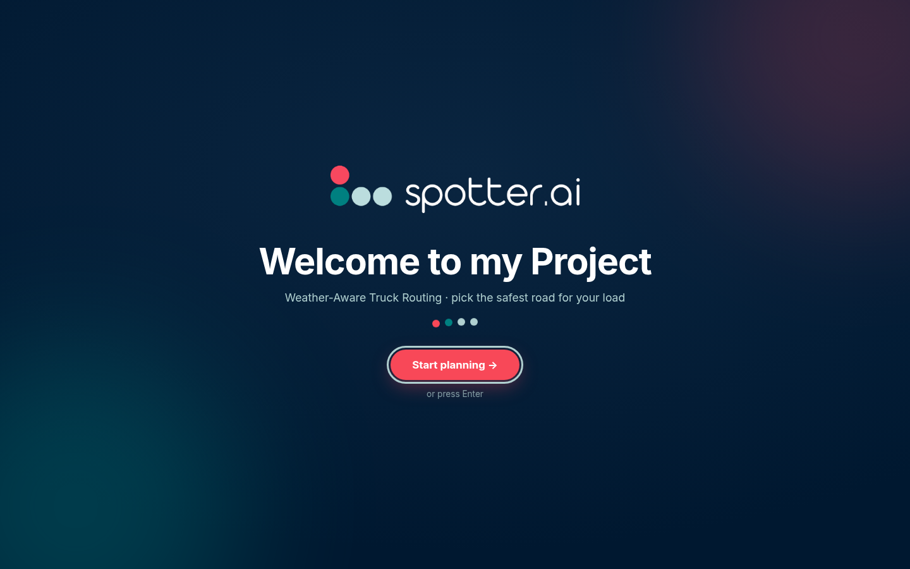
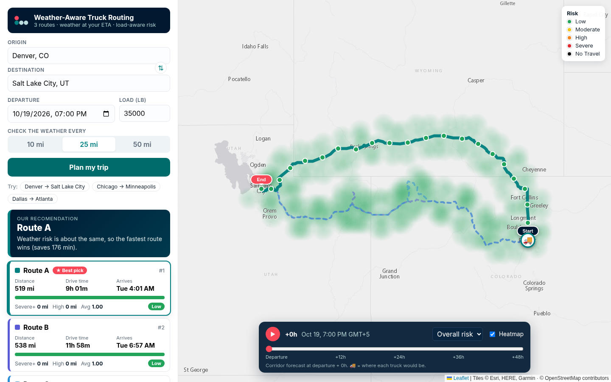
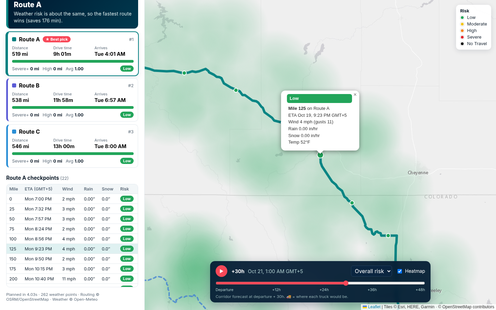

# Weather-Aware Truck Routing 🚚🌧️

A React + Django app that helps a truck driver pick the **safest** route based on
weather (at the truck's actual ETA), load weight, and travel time.

Built for the Spotter Full Stack Developer take-home.

  

## Screenshots

| Splash | Planner | Checkpoint detail |
|---|---|---|
|  |  |  |

## What it does

1. You enter **origin, destination, departure date/time, load weight**, and a **sampling interval (10 / 25 / 50 mi)**.
2. The backend geocodes both places (Nominatim, with Photon as a backup) and asks **OSRM** for driving routes.
   It keeps up to **3 meaningfully different routes** (real OSRM alternatives first; if OSRM returns fewer than
   3, it forces detours through via-points left/right of the main route and drops near-duplicates).
3. It drops a **checkpoint every N miles** (plus start and end) and computes the truck's **ETA** at each one
   from OSRM's per-segment durations.
4. The **browser** fetches **hourly** wind / rain / snow from **Open-Meteo** for all checkpoints (and the corridor
   heatmap) — the Django server never calls Open-Meteo (Render's shared egress IP is rate-limited). Weather is
   **linearly interpolated to each checkpoint's exact ETA**.
5. Each checkpoint gets a **risk level** (same PDF rules, in JS), each route gets a summary (miles per level, Severe+ miles,
   High miles, distance-weighted average risk), and the best route is recommended in the browser.
6. The map shows all 3 routes, risk-colored checkpoints with ETA popups, start/end pins, and a **corridor heatmap**
   with a **0–48 h forecast slider** (play button included). Truck icons show where each route's truck would be
   at the selected hour.

## Risk rules (from the brief)

| Condition | Low | Moderate | High | Severe | No Travel |
|---|---|---|---|---|---|
| Wind | <25 mph | 25–34 | 35–44 | 45–54 | ≥55 mph |
| Rain | <0.10 in/hr | 0.10–0.25 | 0.25–0.50 | 0.50–1.00 | >1.00 |
| Snow | <0.5 in/hr | 0.5–1.0 | 1.0–2.0 | 2.0–3.0 | >3.0 |

Load rules: ≥55 mph → No Travel for any load · 45–54 mph & >30,000 lb → No Travel · 35–44 mph & >40,000 lb → Severe.

A checkpoint's level is the **worst** of its wind / rain / snow levels. Numeric scores: Low=1 … No Travel=5.

**Boundary choices** (the brief's ranges touch, so I picked the safer side): a value exactly on a boundary goes to the
higher bucket (e.g. 35 mph = High, 0.25 in/hr = High), except the rain/snow No Travel line which the brief writes
as `>` (so exactly 1.00 in/hr rain is still Severe).

### Recommendation order

1. Fewest **Severe miles** (Severe **+ No Travel**, so a No Travel road can never look better than a Severe one)
2. Fewest **High miles**
3. Lowest **distance-weighted average risk**
4. Shortest **travel time**

Miles are attributed per checkpoint: each checkpoint "owns" half the gap to its neighbors, so the owned miles sum
to the route length. Tiny differences (<0.5 mi, <0.001 avg risk) count as ties so noise can't flip the answer.

### Units

OSRM returns meters/seconds → miles/hours. Open-Meteo is requested in metric and converted explicitly:
km/h × 0.621371 → mph, rain + showers mm ÷ 25.4 → in/hr, snowfall **cm** ÷ 2.54 → in/hr.

## Project layout

```
weather-truck-routing/
├── backend/                     Django 5 + DRF
│   ├── config/                  settings / urls / wsgi
│   ├── trips/
│   │   ├── views.py             POST /api/plan-trip/, GET /api/health/
│   │   ├── serializers.py       input validation
│   │   ├── services/
│   │   │   ├── find_places.py   geocoding (Nominatim → Photon fallback)
│   │   │   ├── get_roads.py     OSRM routes + detour alternatives
│   │   │   ├── check_points.py  checkpoints, ETAs, miles per risk level
│   │   │   ├── get_weather.py   Open-Meteo batching, unit conversion, ETA interpolation
│   │   │   ├── scary_rules.py   the risk + load rules
│   │   │   ├── pick_road.py     recommendation ranking
│   │   │   ├── heat_dots.py     corridor heatmap points + 0–48h frames
│   │   │   └── plan_trip.py     orchestrates everything
│   │   └── tests/               20 unit/API tests
│   ├── requirements.txt
│   └── .env.example
├── frontend/                    Vite + React 18 + react-leaflet
│   ├── public/                  Spotter logo + favicon
│   └── src/
│       ├── components/          SplashPage, PlannerPage, TripForm, TripMap, RouteCards, CheckpointList, HeatControls, RiskLegend
│       └── lib/                 API client, risk colors, time helpers, custom canvas heat layer
├── Dockerfile                   builds the SPA and serves SPA + API from one container
└── render.yaml                  one-click Render blueprint
```

## Run it locally

Requirements: Python 3.11+ and Node 18+.

**Backend** (http://127.0.0.1:8000)

```bash
cd backend
python3 -m venv .venv && source .venv/bin/activate
pip install -r requirements.txt
cp .env.example .env          # put your email in NOMINATIM_USER_AGENT
python manage.py test trips   # optional: run the tests
python manage.py runserver
```

**Frontend** (http://localhost:5173, proxies `/api` to :8000)

```bash
cd frontend
npm install
npm run dev
```

### Single-server / production mode

```bash
cd frontend && npm run build          # -> frontend/dist
cd ../backend && DJANGO_DEBUG=false gunicorn config.wsgi -b 0.0.0.0:8000
```

Django (WhiteNoise) serves the built SPA and the API from the same origin. Restart gunicorn after rebuilding the
frontend. Or with Docker:

```bash
docker build -t truck-routing . && docker run -p 8000:8000 truck-routing
```

To host the frontend separately (Vercel/Netlify), set `VITE_API_BASE_URL` to the backend URL and add the frontend
origin to `CORS_ALLOWED_ORIGINS` on the backend.

## API

`POST /api/plan-trip/`

```json
{
  "origin": "Denver, CO",
  "destination": "Salt Lake City, UT",
  "departure_iso": "2026-10-20T14:00:00Z",
  "load_lbs": 35000,
  "sample_miles": 25
}
```

`origin`/`destination` also accept `"lat, lon"`. Response (trimmed):

```json
{
  "origin": {"name": "...", "lat": 39.74, "lon": -104.98},
  "routes": [{
    "id": "a", "label": "Route A", "source": "osrm-primary", "rank": 1, "recommended": true,
    "distance_miles": 518.7, "duration_hours": 9.02, "arrival": "...Z",
    "geometry": [[lat, lon], ...],
    "checkpoints": [{"mile": 75.0, "eta": "...Z", "weather": {"wind_mph": 5.1, "rain_in_hr": 0, "snow_in_hr": 0},
                     "risk": {"level": "Low", "score": 1, "reasons": []}, "miles_covered": 25.0}],
    "summary": {"miles_by_level": {...}, "severe_miles": 0, "high_miles": 0, "avg_risk": 1.0, "worst_level": "Low"}
  }],
  "recommendation": {"route_id": "a", "reason": "..."},
  "heatmap": {"times": [...49], "points": [[lat, lon]], "risk": [[...]], "wind_mph": [[...]], "rain_in_hr": [[...]], "snow_in_hr": [[...]]}
}
```

## Performance notes

* Open-Meteo calls are batched (60 locations / request, 4 in parallel) and de-duplicated on a ~1 km grid.
* Route polylines are simplified server-side (Douglas–Peucker) before being sent; JSON is gzipped.
* The heatmap is a small custom Leaflet canvas layer: all 49 hourly frames come down with the plan, so moving the
  slider is a pure client-side redraw (~2 ms). Blobs are painted in their risk-bucket color (scariest on top)
  instead of additive heat, so lots of overlapping "Low" dots never fake a "Severe" hotspot.
* OSRM, geocoding, and weather responses are cached in-process (LocMem) for 15–30 min.

## Known limitations

* **OSRM's public demo server is car-only** (no truck height/weight restrictions) and rate-limited — fine for a demo,
  not production. `TRUCK_DURATION_FACTOR` can stretch ETAs for slower trucks. Swap `OSRM_BASE_URL` for a self-hosted
  OSRM truck profile or a commercial truck router in production.
* Detour "alternatives" are forced via-points and can be noticeably longer than the fastest route.
* Hours-of-service breaks are not modelled; ETAs assume continuous driving.
* Open-Meteo's free tier is ~10k location-calls/day; a 2,800 mi trip at 10 mi sampling uses ~900. Departures are
  limited to 3 days ago → 10 days ahead (forecast horizon).
* Open-Meteo hourly precipitation is the total for the preceding hour, used as the in/hr rate.
* Nominatim requires an identifying `User-Agent` and ~1 req/s; generic agents and some cloud IPs get 403, which is why
  Photon is used as a fallback.

## Credits

Routing © OSRM / OpenStreetMap contributors · Geocoding © Nominatim / Photon (OSM) · Weather © Open-Meteo ·
Map tiles © Esri. Spotter logo used for the take-home splash page only.
